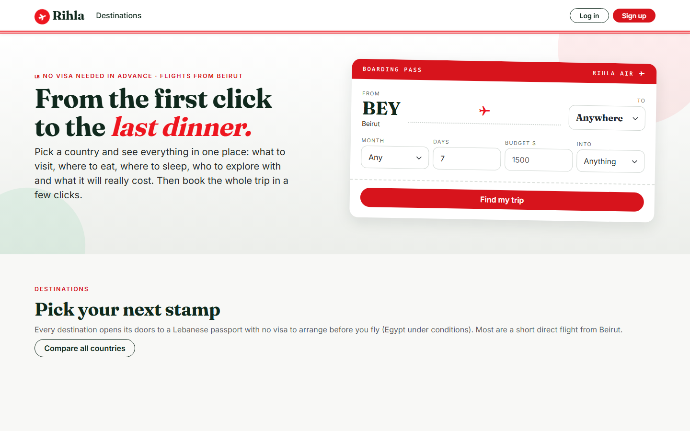
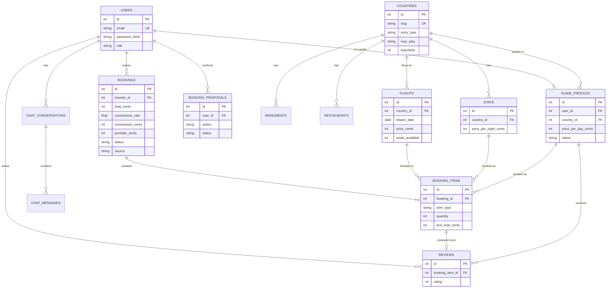
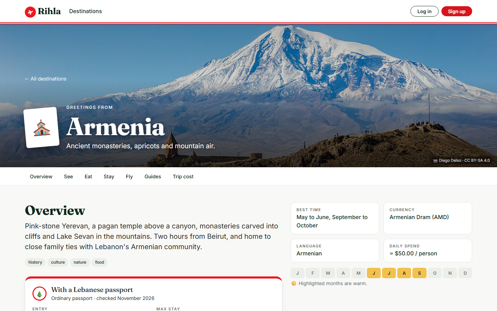
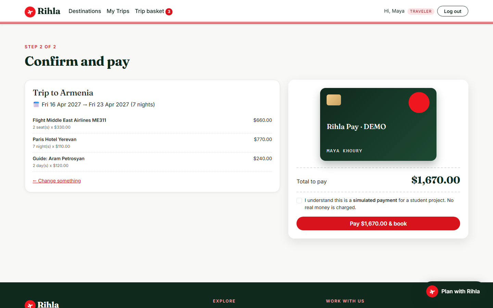
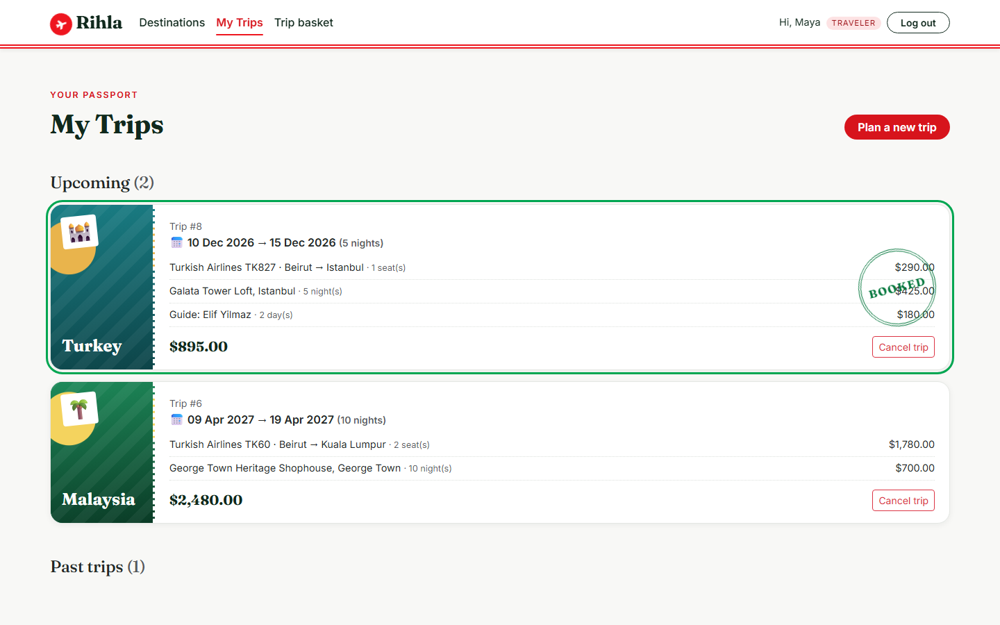
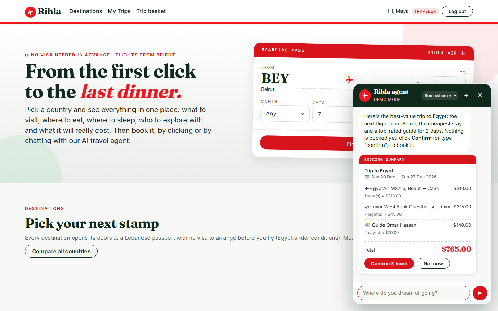
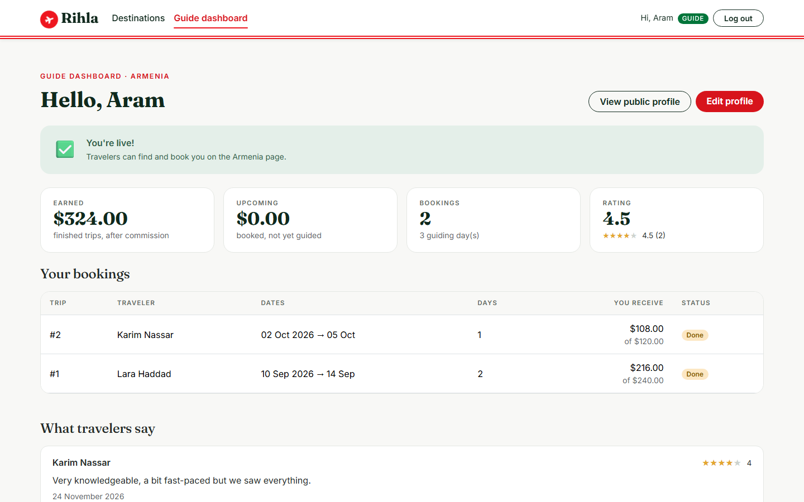
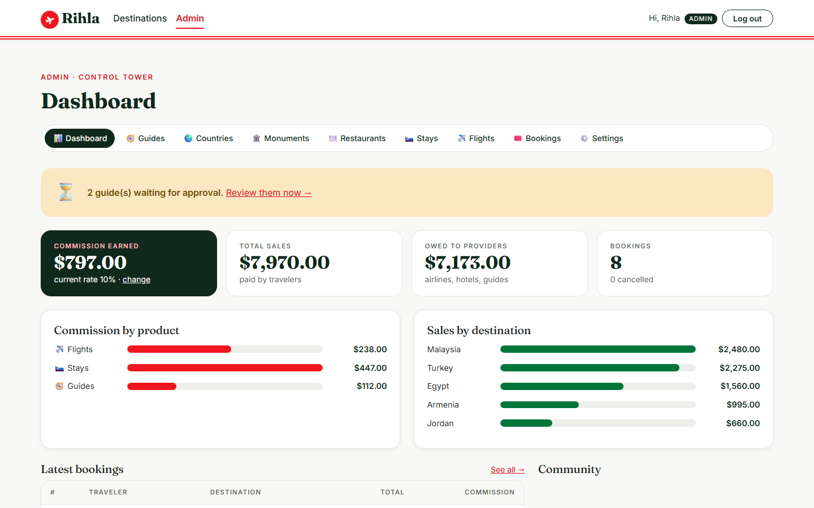
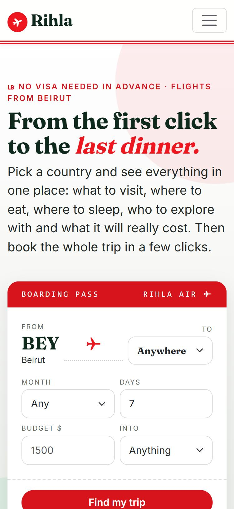

# 🇱🇧 Rihla: from the first click to the last dinner

**Rihla** (رحلة, "journey") is an online travel agency for **Lebanese travelers**. It only sells trips to countries
that a Lebanese passport can enter **without arranging a visa in advance**. Pick a country and everything is
in one place: entry rules, monuments, food, hotels, flights from Beirut, approved local guides and the real
cost of the trip. Then book it by clicking, or by chatting with an **AI travel agent**.

> GIN446 Web final project, Group 5: **Joe Atallah** and **Gebran Gebran**. Flights, hotels and payments are **simulated**: no real money is charged.



---

## Contents
- [Features](#features)
- [The AI travel agent](#the-ai-travel-agent)
- [Technologies](#technologies)
- [Database design](#database-design)
- [Project structure](#project-structure)
- [Setup and run locally](#setup-and-run-locally)
- [Test logins](#test-logins)
- [Automated tests](#automated-tests)
- [Security](#security)
- [Screenshots](#screenshots)
- [Credits and sources](#credits-and-sources)

---

## Features

### Destinations (visa-free for a Lebanese passport)
| Country | Entry | Max stay | Direct flight from Beirut |
|---|---|---|---|
| 🇹🇷 Turkey | Visa-free | 90 days in any 180 | Yes |
| 🇦🇲 Armenia | Visa on arrival | 120 days per year | Yes |
| 🇪🇬 Egypt | Visa-free under conditions (charter to Sharm / Hurghada, groups, under 16 / over 50) | 90 days in any 180 | Yes |
| 🇯🇴 Jordan | Visa-free | 3 months in any 6 | Yes |
| 🇬🇪 Georgia | Visa-free (health insurance required) | 1 year | Summer only |
| 🇲🇾 Malaysia | Visa-free | 90 days in any 180 | No (via Doha / Dubai / Istanbul) |

Each country page shows a **"With a Lebanese passport"** card (entry type, maximum stay, direct flight,
popularity with Lebanese travelers, conditions), real photos, monuments with entry prices, restaurants with a
must-try dish, stays, flights with seats left, approved guides with ratings, and a **live trip-cost calculator**.
The research behind the list is in [docs/VISA_RESEARCH.md](docs/VISA_RESEARCH.md). Visa rules change: the site
reminds travelers to confirm with official sources.

### Three roles
**Traveler**
- Sign up, log in, log out.
- Search destinations by month, days, budget, interest, and "no visa needed in advance".
- Add a flight, a stay and a guide to a **trip basket**, then pay on a **simulated checkout**.
- **My Trips**: upcoming, past and cancelled trips; cancel an upcoming trip (flight seats are released).
- **Rate a guide** (1-5 stars + comment), only after a finished trip with that guide.
- Chat with the **AI travel agent** on every page.

**Guide**
- Sign up as a guide (country, languages, bio, daily price). The profile stays **pending** until an admin approves it.
- Dashboard: approval status, bookings, **earnings after commission**, average rating and reviews.
- Edit the profile (a rejected guide who edits is sent back for approval).

**Admin**
- Dashboard: total sales, **commission earned**, money owed to providers, bookings by product and destination.
- Approve / reject guides.
- Full create / edit / delete for countries, monuments, restaurants, stays and flights.
- All bookings with filters (status, website vs AI agent), and the **commission rate** setting.

### Business rules
- The platform keeps a **commission** (10% by default, set by the admin) on every flight, stay and guide booked.
  Each booking stores the total, the commission and the amount owed to the provider, plus the rate used at
  booking time (changing the rate never rewrites old bookings).
- Booking a flight **reduces the seats**; cancelling **restores** them. Seats are taken with one conditional SQL
  `UPDATE`, so a flight can never be overbooked.
- A guide's **star rating** is the average of reviews from travelers who **actually booked** that guide
  (one review per booking).
- A trip must start in the future, stay in one country, match the flight dates, and not book more nights or
  guide days than it lasts. These rules live in one function, `services/booking.py → create_booking()`, used by
  the checkout page **and** the AI agent.

---

## The AI travel agent

A floating chat on every page (for travelers). Example:

> **You:** I want somewhere warm in March for 5 days, budget $1500.
> **Rihla:** Egypt and Malaysia are both warm in March… *(country cards)*
> **You:** Plan a trip to Egypt with a guide.
> **Rihla:** *(booking summary with flight, hotel, guide and total)* Click **Confirm** to book it.

**How it works (tool calling):** the agent never invents data and never touches the database itself. It can only
ask the server to run one of **9 tools**, which answer from our own database with the same code as the website:

`search_countries` · `get_country_details` · `search_flights` · `search_hotels` · `list_guides` ·
`estimate_trip_cost` · `create_booking` · `list_my_bookings` · `cancel_booking`

```
Browser chat ──fetch──► /api/chat ──► Gemini or Claude API (or demo mode)
                                         │ "call search_flights(to_country='Egypt')"
                                         ▼
                              agent/tools.py ──► services/ ──► SQLite
```

- **Confirmation step:** `create_booking` and `cancel_booking` only prepare a **proposal** and show a summary
  card. Nothing is booked until the logged-in traveler clicks **Confirm** (or types "confirm"). The real booking
  then goes through the same `create_booking()` as the checkout page.
- **Only your own data:** the user is always taken from the session, never from the AI.
- **Rate limit:** 20 messages per traveler per hour (configurable).
- **History:** conversations are saved in the database and can be continued later.
- **Demo mode:** without an API key, a rule-based agent understands fixed requests ("where can I go without a
  visa?", "find flights to Armenia", "book the cheapest hotel in Armenia", "plan a trip to Egypt", "my bookings",
  "cancel trip 6") and calls the **same tools**. If the AI service is down, the chat falls back to demo mode
  automatically, so a presentation never breaks.

### Turning on the real AI (Gemini, free, or Claude)
The agent works with two AI providers. Both use the **same 9 tools and the same rules**
(`agent/gemini_agent.py` and `agent/claude_agent.py` share the system prompt).

| Provider | Cost | Get a key | `.env` |
|---|---|---|---|
| **Google Gemini** | Free tier (limited requests per minute and per day) | [aistudio.google.com](https://aistudio.google.com) → **Get API key** | `AI_PROVIDER=gemini` |
| **Claude** | Paid, per use | [platform.claude.com](https://platform.claude.com) → **API Keys** | `AI_PROVIDER=claude` |

1. In the project folder, copy the example settings file and open it:
   ```powershell
   Copy-Item .env.example .env
   ```
2. Set the provider and paste your key, for example:
   ```
   AI_PROVIDER=gemini
   AI_API_KEY=your-key-here
   ```
3. Restart the app. The chat header shows **AI · Gemini** (or **AI · Claude**) instead of **Demo mode**.

`AI_MODEL` can stay empty: the default is `gemini-3.8-flash` for Gemini and `claude-opus-5-5` for Claude.
On Gemini's free tier, Google may use what is sent to improve its products, so only use test data.
If the free-tier limit is reached, the chat answers in demo mode until the limit resets.

The key lives **only** in `.env` on the server. It is never sent to the browser, and `.env` is in `.gitignore`.

---

## Technologies

| Technology | Role |
|---|---|
| **HTML5, CSS3, JavaScript** | Pages, styling (Lebanese flag palette), calculator and chat (`fetch()`) |
| **Bootstrap 5** | Responsive grid and components (phone and desktop) |
| **Python 3.12 + Flask 3** | Back end: routes split into Blueprints (public, auth, traveler, guide, admin, agent) |
| **Jinja2** | HTML templates with one shared layout |
| **SQLite + Flask-SQLAlchemy** | Database and models (PostgreSQL on Render through `DATABASE_URL`) |
| **Werkzeug security** | Password hashing (`generate_password_hash` / `check_password_hash`, scrypt) |
| **python-dotenv** | Loads secrets from `.env` |
| **Google Gen AI SDK** (`google-genai`) | Calls the Gemini API (free tier) for the AI travel agent |
| **Anthropic Python SDK** | Calls the Claude API for the AI travel agent (paid option) |
| **Gunicorn** | Production server (Render) |
| **Git + GitHub, VS Code** | Version control and editor |

---

## Database design

13 tables. Money is stored as **whole cents** (integers), so $12.50 is `1250` and there are no rounding errors.



Also: `settings` (commission rate) and `chat_messages` (text shown + the exact AI blocks for replay).
The full SQL is in [database/schema.sql](database/schema.sql) (generated from `models.py`).

---

## Project structure

```
rihla/
├─ app.py               application factory, error pages, CLI commands (init-db, db-summary)
├─ config.py            settings read from .env
├─ extensions.py        SQLAlchemy object + SQLite foreign keys ON
├─ models.py            the 13 tables as Python classes
├─ seed.py / photos.py  sample data (6 countries, users, bookings) and real photo credits
├─ security.py          login sessions, @role_required, CSRF tokens
├─ validators.py        server-side form validation
├─ services/            business logic shared by pages and the AI
│  ├─ booking.py        create_booking / cancel_booking / preview_booking (the ONLY booking code)
│  ├─ pricing.py        commission split, trip estimate, money formatting
│  ├─ search.py         countries, flights, stays, guides with ratings
│  ├─ basket.py         trip basket stored in the session
│  └─ reviews.py        who may review a guide
├─ agent/               AI travel agent: tools, proposals, Gemini and Claude loops, demo mode, chat storage
├─ blueprints/          routes: public, auth, traveler, guide, admin (+ admin_resources), agent (JSON API)
├─ templates/           Jinja pages (layout.html + one folder per role)
├─ static/              css/style.css, js/main.js, js/calculator.js, js/chat.js
├─ database/schema.sql  exported SQL schema
├─ tests/               automated tests (Python's built-in unittest)
└─ docs/                PLAN.md (design plan), VISA_RESEARCH.md (sources), screenshots/
```

---

## Setup and run locally

Requirements: **Python 3.12** (on Windows, the `py` launcher) and Git.

```powershell
git clone https://github.com/web446/rihla.git
```
```powershell
cd rihla
```
```powershell
py -m venv .venv
```
```powershell
.venv\Scripts\activate
```
```powershell
pip install -r requirements.txt
```
```powershell
Copy-Item .env.example .env
```
Optionally put a random `SECRET_KEY` in `.env`
(`py -c "import secrets; print(secrets.token_hex(32))"`), then create the database with sample data and run:
```powershell
flask --app app init-db
```
```powershell
flask --app app run --debug
```
Open **http://127.0.0.1:5000**. `flask --app app init-db` can be run again at any time to reset all data.

macOS / Linux: use `python3 -m venv .venv`, `source .venv/bin/activate` and `cp .env.example .env`.

---

## Test logins

Local, fake accounts created by `init-db`:

| Role | Email | Password | What to try |
|---|---|---|---|
| Traveler | `traveler@rihla.test` | `Traveler123!` | Book a trip, cancel it, rate the guide of the past Cappadocia trip, chat with the agent |
| Guide | `guide@rihla.test` | `Guide123!` | Aram Petrosyan (Armenia): earnings, reviews, edit profile |
| Admin | `admin@rihla.test` | `Admin123!` | Approve the pending guides (Nino, Daniel), edit content, change the commission |

---

## Automated tests

79 tests check the main rules of the site. They use Python's built-in **unittest**, so nothing extra
has to be installed. From the `rihla` folder:

```powershell
.venv\Scripts\python -m unittest -v
```

Each test starts from a fresh copy of the sample data in a **temporary database**, so the tests can run
in any order and never change `instance/rihla.db`. No API key or internet is needed: the AI agent is tested in
demo mode, and the Gemini agent with a fake Gemini client that returns prepared answers.

| File | What it checks |
|---|---|
| `tests/test_booking_rules.py` | Password hashing, commission maths, no overbooking, cancelling gives seats back, invalid trips refused |
| `tests/test_auth.py` | Login, sign-up, guide sign-up (pending), roles (403), CSRF, logout is a POST, no open redirect |
| `tests/test_public_pages.py` | Every country page opens, trip-cost estimate, search filters, pending guides hidden |
| `tests/test_basket_checkout.py` | Basket total, simulated checkout, booking amounts, My Trips, cancel, privacy between travelers |
| `tests/test_reviews_and_guides.py` | Rating a guide once (past trips only), guide earnings, admin approves / rejects guides |
| `tests/test_admin.py` | Admin pages, adding and editing content, seat rules, delete rules, commission setting |
| `tests/test_agent.py` | AI agent answers, booking only after Confirm, cancelling, users only see their own chats, rate limit |
| `tests/test_gemini_agent.py` | Gemini tool loop, saved history, Confirm rule, errors fall back to demo mode, switching providers |

The sample data uses fixed dates (flights from December 2026 to 2027), so the tests are meant to run before those flights leave.

---

## Security

- Passwords are **hashed** with scrypt (Werkzeug), never stored in plain text.
- **Sessions** are signed cookies; only the user id is stored, and the user is reloaded on every request.
- Every protected page uses **`@role_required(...)`**: wrong role → 403, not logged in → login page.
- **CSRF tokens** on every form and on every chat API call; logout is a POST.
- **SQL injection** is prevented by SQLAlchemy's bound parameters (no SQL built from strings).
- **XSS** is prevented by Jinja's automatic escaping and `textContent` in JavaScript.
- **Validation** on the server for every form (the browser checks are only a convenience).
- Secrets live only in `.env`, which is never committed (`.env.example` shows the variables).

---

## Screenshots

> Taken from the running site with the sample data (`flask --app app init-db`); the AI agent is in demo mode.

| Page | Screenshot |
|---|---|
| Homepage |  |
| Country page + Lebanese passport card |  |
| Trip basket and simulated checkout |  |
| My Trips |  |
| AI travel agent |  |
| Guide dashboard |  |
| Admin dashboard |  |
| Phone view |  |

---

## Credits and sources

- **Photos:** 35 real photographs from [Wikimedia Commons](https://commons.wikimedia.org), under Creative Commons
  or public-domain licences. Every author and licence is listed on the site's **Photo credits** page (`/credits`)
  and in [photos.py](photos.py). No image is AI-generated.
- **Visa and travel research:** sources listed in [docs/VISA_RESEARCH.md](docs/VISA_RESEARCH.md)
  (Wikipedia, Beirut airport statistics, Turkish embassy, flight trackers). Rules change: always check official sources.
- **Fonts:** [Fraunces](https://fonts.google.com/specimen/Fraunces) and [Inter](https://fonts.google.com/specimen/Inter) (Google Fonts, SIL Open Font License).
- **Bootstrap 5** (MIT License).
- Hotels, restaurants and monuments are real places; prices, flights, guides and travelers are **simulated** for this project.
- Development was assisted by Claude (Anthropic), an AI assistant, as declared in the project report.
